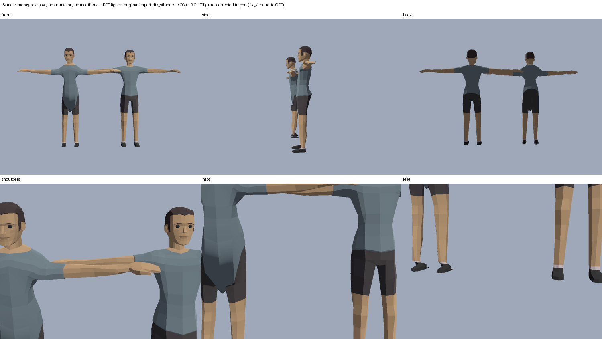
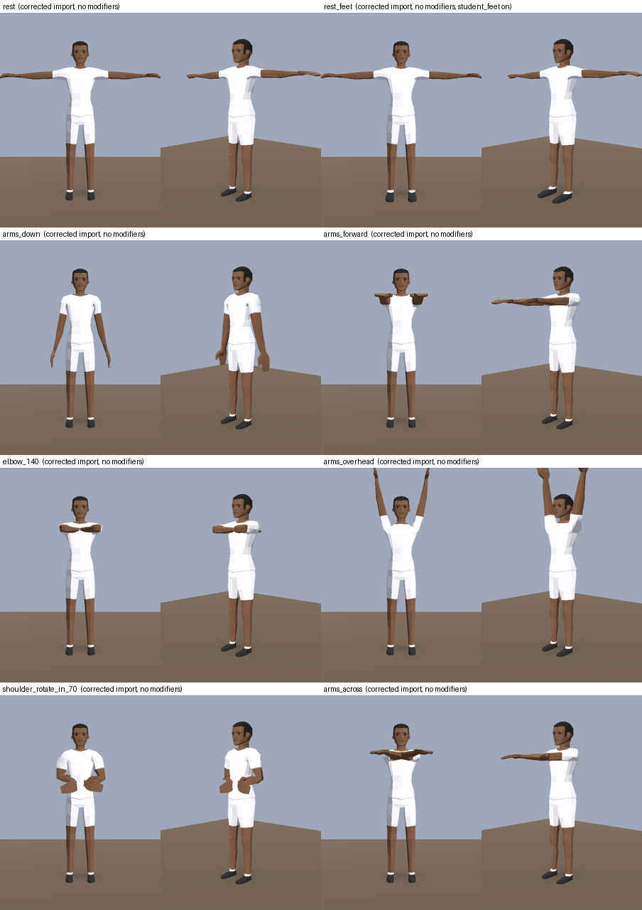
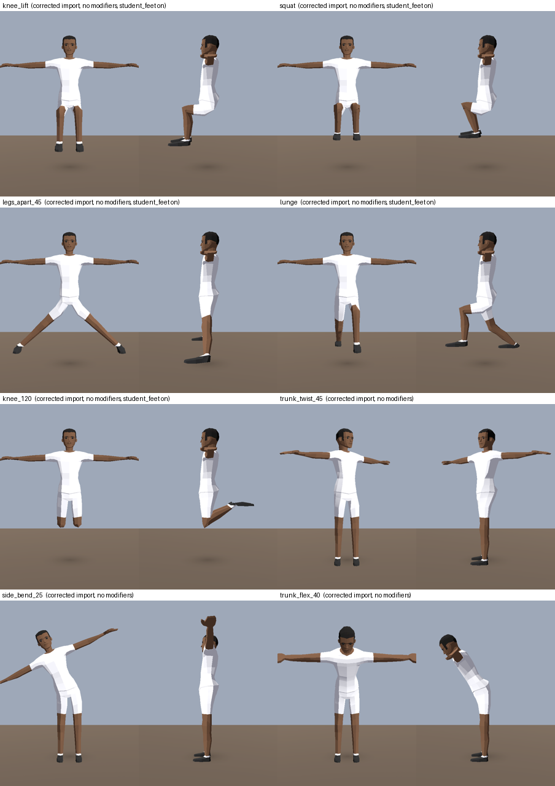
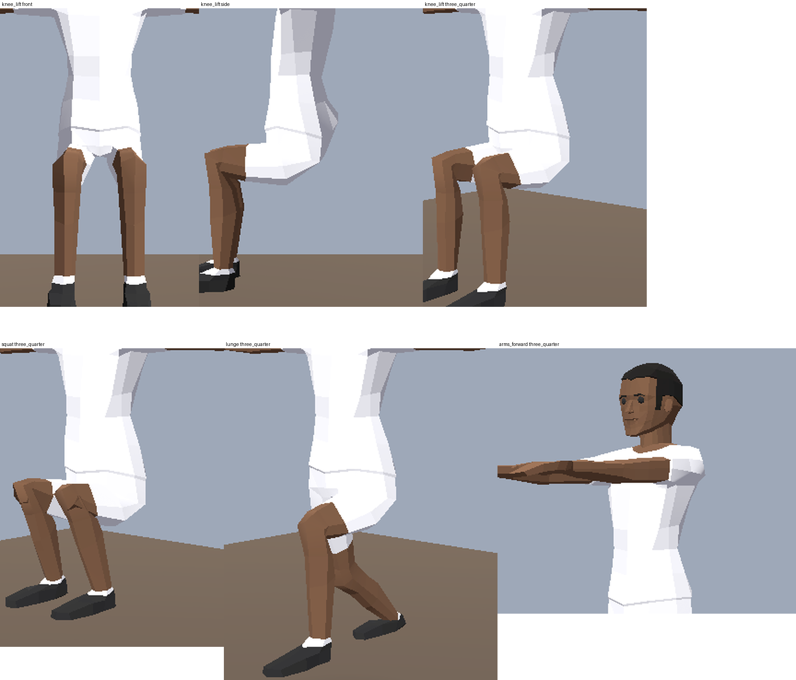

# Bind-pose import fix: step 1 report

Branch `rig/bind-pose-import`, from `rig/certification`. The only change to the
game is one import setting: `Male_Casual.fbx.import` now has
`retarget/rest_fixer/fix_silhouette/enable = false`, so the student is imported
at the pose its skin was bound in.

Scope was limited on purpose. Nothing changed in IK, animation controllers,
gameplay, clips or corrections. The game's clips are therefore still built for
the old rest; they are step 2 ("Not in scope" below). This report covers the
unmodified skinned character only.

## 1. Same cameras, original import vs corrected import

Both are at their own rest pose, with no animation and no modifier
(`tests/rig/bind_compare.tscn`). Left is the original import; right is the
corrected one.

The original import:
- the shirt hangs over the shorts like a dress;
- the shorts are pinched;
- the shoes are torn into spikes;
- the clavicles are flattened.

The corrected import shows the mesh as it was modelled: shirt to the waist,
shorts intact, shoes whole with their sock cuffs.

## 2. Bind-pose measurements

From `bind_compare` (headless). Distances assume a 1.81 m body.

| | original import | corrected import |
|---|---|---|
| Bone pairs that place a shared vertex >0.5 cm apart at rest | 34 (worst 69.7 cm, Chest/Hips) | **0** (worst 0.0 cm) |
| Hip joint bound from its rest | (-0.2, +11.5, -6.7) cm | 0.0 |
| Knee | (-0.2, +11.6, -8.1) cm | 0.0 |
| Shoulder (upper arm) | (∓3.3, +7.7, +1.5) cm | 0.0 |
| Elbow | (-3.5, +6.1, -1.0) cm | 0.0 |
| Shoe control | (-0.1, +14.8, -9.2) cm | 0.0 |
| Mesh height at rest (skeleton units) | 5.193 (stretched) | 4.841 (as modelled) |

The mesh is now exactly symmetric: 95% of arm vertices lie within 0.00 cm of
their mirror image, against 1.24 cm on the original import, where the
distortion itself was asymmetric.

## 3. Gate 1 (skeleton), corrected import: 6 of 32 fail

- **Now passing:** rest pose = skin bind pose (0 pairs); every bind joint at
  0.0 cm; the shoulder, hip, knee and ankle joints mirror within 0.6 cm.
  Passing as before: hierarchy, unit scale, no clip bone scale, body frame,
  mirror convention, elbow and knee hinge axes, and the arm IK pole axis (-Z).
- **Left elbow joint misplaced (this survives the fix).** The left upper arm is
  27.4 cm and the right 25.2 cm (+8.8%); the elbow is 2.8 cm and the wrist
  2.4 cm out of mirror. The mesh is now perfectly symmetric and the left
  elbow sits 3.9 cm from where its skin bends (the right 1.1 cm), so this is a
  joint placement error in the original artist's rig, not the import. Fixing it
  means moving the left elbow and wrist rest and rebinding those bones: a
  separate, small rig edit.
- **Hip pivot 5.6 cm below where the skin bends** (11.6 cm before). This is
  the artist's rig; the knee-lift deformation below decides whether it matters.
- The clavicle's local +Y points 46 deg off its child. This is an axis
  convention from the rest fixer's axis overwrite; direction-based retargeting
  does not use it.
- Proportions: thigh -30%, upper arm -21%, ankle at the sole (-73%). These
  belong to the mesh and rig design.

## 4. Gate 2 (skin), corrected import: 22 of 45 fail

- **Rest vs modelled: all 17 body regions 1.00x** (12 failed on the original
  import).
- **Trunk, neck and head pass their full range**: flex 40, extension 20,
  twist 45, side bend 25, head turn 60, nod 30.
- **The joint-range poses look acceptable at early-PS2 quality**, apart from
  three visible defects (the close-ups below). The numbers fail the limits I
  set before measuring (1.6x stretch, 0.5x squash): shoulders 1.4-2.0x,
  thigh/pelvis squash 0.08x at knee lift. They overstate what shows on this
  low-poly mesh and need calibrating against renders. That is a decision, so I
  have not changed them.

Visible defects in the corrected skin itself (no game code involved):
- Squat (120 deg knees): the knee crease pinches.
- Lunge: a stray white patch at the front knee.
- Knee lift: a small gap at the shorts' inner crotch.

## 5. Compensations: which might now be redundant

Evidence on this branch, against the old import's measurements:

| Compensation | What it compensated | Status with the corrected import | Evidence |
|---|---|---|---|
| `student_feet` constants (`SHOE_AHEAD` 0.10, `SHOE_BELOW_ANKLE`, `SHOE_FLOOR_Y`, `SHOE_SCALE` 1.14) | shoe controls moved 14.8 cm off their bind | **now wrong**: places the shoe 3.7 cm ahead of where it is modelled and stretches it 6.7x (L) / 1.9x (R) against the cuff | gate 5 "student_feet puts the shoe where it was modelled" (placed 3.7 cm off); gate 2 "rest_feet vs modelled". A rest-derived offset was tried on the parked branch and places it at 0.0 cm. |
| `CourtPlayerModel._crotch_reweighted` | the shorts seam spiking in slides | **already inert**: changes 0 of 3,966 vertices on both imports (so also on `dev`) | a weight diff of `_crotch_reweighted`'s output against its input; gate 2 is identical with `-- skin=no_reweight` |
| `build_student`'s Hips->Spine bind rename | waist following the body controller | **undetermined**: gate 2 is identical with and without it, but none of its poses moves Hips and Spine apart | gate 2 `-- skin=raw`; needs a pose that tilts the pelvis against the controller |
| `GROUND_OFFSETS` (per-clip floor offsets) | clips landing high or low on the old rest | measured on the old rest, so invalid | step 2: clips re-floored on the new rest |
| Library clips copied bone for bone (Idle, Walk, Jog, Sprint, Jump; JogM, Run) | relied on both skeletons having the silhouette fix | **incompatible**: they no longer fit the student | gate 5: `foot_floor_body` has to lift Idle 1.0 cm; the parked branch shows these clips must go through MocapRetarget |
| `MocapRetarget` floor reference (the old copied clip's lowest ankle) | | invalid once the copied clips are | step 2 |
| `court_actor._normalise_height` (joint-sum scale) | | scales the corrected body 8% bigger (model 0.984 vs 0.911): the Hips controller and hip joints moved | step 2: scale by the drawn height |
| `torso_posture` | folded library clips | re-audit after step 2 (the fold may have been partly the import's trunk stretch) | `tests/trunk_lean_audit` after re-retargeting |
| `foot_floor` (per-foot lift) | feet under the floor | inert on this rig whatever the import (no toe bones); foot contact is `foot_floor_body` | gate 5 note. Decide: remove or replace. |

## Not in scope (deliberately untouched)

- Clips, retargeting, height scaling, `student_feet`, corrections, IK. On this
  branch the game runs the old clips on the new rest and is **not playable as
  intended**; it is an experiment, not for merge.
- Gates 3-5 run here (all eight injected faults still caught), but their
  results use Idle and JumpShot frames built for the old rest, so they mean
  nothing until step 2.

## Step 2 starting point

The parked branch `wip/retarget-onto-bind-rest` (266a8f5, unreviewed) has:
- every clip through MocapRetarget;
- the floor at the rest ankle;
- the rest-derived shoe offset;
- scale by mesh height.

Its regression run against the baseline:
- `rebound_checks` 0 → **4 failures**;
- `court_runtime_qa` still 2 of 25 failing, but a different pair ("defense to
  jog" in place of "loco: idle");
- `clip_fidelity` unchanged, everything else the same.

Those are step 2's work.

## Certification requirement changes (also on this branch)

- **Missing toe bones are not a failure.** Gate 1 notes them. Gate 5 tests the
  foot contact the rig supports (`foot_floor_body`) and reports `foot_floor` as
  inert.
- **Leg IK is an optional capability.** Gate 3's leg checks print `OPTIONAL`
  and do not fail the gate. Any leg IK the game adopts must pass them.
- **The 94% reach cap is a gameplay policy.** Gate 4 prints it as `POLICY`. The
  rig's physical reach (99.5% of the chain) is still checked.
