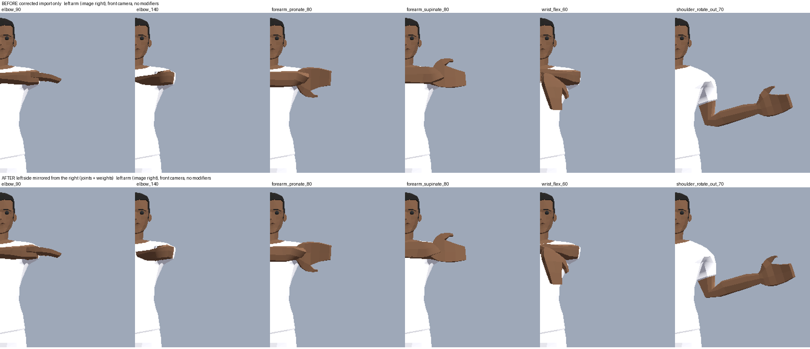
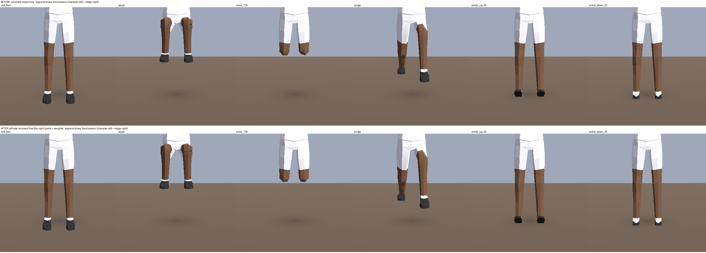
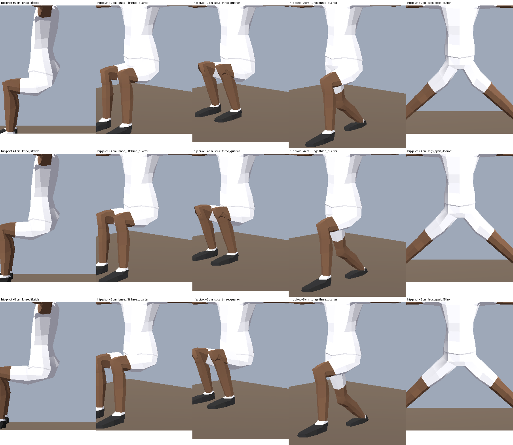

# Structural joint alignment: report

Branch `rig/joint-alignment`, built on the corrected import (`rig/bind-pose-import`).

The question: which of the Gate 1 failures that survived the bind-pose fix are
genuine rig defects, and which are intentional conventions? Only confirmed
defects are fixed, and the corrected bind/rest relationship is kept. Clips,
retargeting, IK, corrections and gameplay are untouched.

The fix is applied once, at import:
- `assets/court/students/student_rig_fix.gd` is the FBX's post-import script.
- It uses `scripts/court/rig_joints.gd`, which moves joints and copies weights
  while rebinding the skin, so the rest mesh never changes.

## Findings

### 1. Left arm: genuine defect, fixed
The corrected import made the mesh exactly symmetric (0.00 cm), which exposed
a left/right difference in the rig itself.

| Left vs mirrored right | Before | After |
|---|---|---|
| Clavicle and shoulder joints | 0.6 cm | 0.0 |
| Elbow | 2.8 cm out | 0.0 |
| Wrist | 2.5 cm | 0.0 |
| Palm | 2.0 cm | 0.0 |
| Finger base | 1.3 cm | 0.0 |
| Upper arm length | 27.4 vs 25.2 cm (+8.8%) | 25.2 vs 25.2 cm |
| Elbow pivot from where its skin bends | 3.9 cm (right: 1.1) | 1.1 cm (right: 1.1) |
| Hand, palm and finger vertices weighted unlike their mirror | 45 of 61, 32 of 40, 20 of 20 | 0 |

**Interpretation.** The upper arm and forearm weights were already symmetric,
so the elbow was a pure pivot error. The left hand, though, had been skinned
around its own shifted wrist and palm pivots. Moving those pivots alone made it
deform worse: wrist flexion went from 1.09x to 1.85x. So the left arm takes the
right arm's joints and weights, mirrored. It now deforms exactly like the
right in every Gate 2 arm pose:
- pronation squash 0.34 → 0.55;
- supination 0.44 → 0.65;
- shoulder rotation stretch 1.75 → 1.57;
- elbow 90: 1.23 → 1.31, now the same as the right.

### 2. Left leg: genuine defect, fixed (found while checking the arm)
Against the right, 16 of 84 left shin vertices and 14 of 62 left shoe vertices
were weighted differently, and the left leg's joints sat 0.6 cm off. The leg
takes the right leg's joints and weights, mirrored. 9 left waist vertices
weighted up to 0.38 off their twins were mirrored too; 6 waist vertices have
no twin within 0.7 cm and are left as they were.

| Gate 2 (left) | Before | After (= right) |
|---|---|---|
| Squat, shin squash | 0.07x | 0.18x |
| 120 deg knee, shin squash | 0.07x | 0.18x |
| Ankle up 30, shin/shoe stretch | 2.48x | 1.08x |
| Ankle down 30 | 3.47x | 1.94x |
| Rest with student_feet | 8.95x | 1.91x (the remaining failure is student_feet's old constants: step 5) |

### 3. Hip pivot: not a confirmed defect, kept
The anatomical hip joint (`LeftUpperLeg`, 80.6 cm) sits 2.9 cm below the
crotch (83.5 cm), where a real 1.81 m body has it about 10 cm above. But the
skin was painted around this pivot: the thigh weights start at 75 cm on the
inside and 88.7 cm on the outside.

Raising both pivots 4 and 8 cm, rebound so the rest mesh is unchanged
(`skin_deformation_checks -- hip_up=<cm>`), trades one problem for another:
- knee lift: hip-crease squash 0.08 → 0.20 → 0.33-0.41x, and the shorts read
  smoother;
- thigh stretch rises (1.41 → 1.59x);
- the lunge gets visibly worse: the shorts hem drags down the front thigh, a
  larger white patch at +4 and larger again at +8;
- squat and legs-apart are about the same.

The pivot is consistent with the skin, so moving it would also mean repainting
the hip weights. Kept.

`Hips` (79.3 cm) is the body controller and `Spine` (73.2 cm, below the hip
joints) the pelvis/waist bone. Both are control conventions of this rig
(RIG_SPEC.md) and are not changed.

### 4. Other Gate 1 failures: conventions or design, kept
- **The clavicle's local +Y points 46 deg off its child.** An axis
  convention, unused by direction-based retargeting.
- **Proportions** (thigh -30%, upper arm -24%, ankle at the sole). These are
  the mesh's design.
- **Thumb parenting.** `Thumb1.L` hangs off `LeftHand`, `Thumb1.R` off
  `MiddleHand.R`, with the same joint positions. It only matters if a clip
  animates `MiddleHand`. Noted, not changed.

## Gates after the fix

- **Gate 1: 3 of 33 fail.** The clavicle axis, the proportions and the hip.
  Before the fix it was 6 of 32 (new check: weight symmetry). Rest = bind still
  holds (0 pairs).
- **Gate 2: 22 of 45 fail.** Left and right now give identical numbers. The
  rest vs modelled checks pass in all 17 regions.
- **Injected faults: all eight caught.** The weight-mirror check now also
  catches `bone_offset`.

## Harness changes

- **Gate 1 checks that the skin weights mirror.** Every left vertex must be
  weighted as its right twin.
- **Gate 2 no longer measures stretch on edges shorter than 5 mm.** A 1.4 mm
  sliver on the left shoe cuff read 9x while both shoes skin to within 0.16 cm.
  On this rig the change affects only shoe and foot regions; it is a fix to the
  measure, not a looser limit.
- **Gate 2 `hip_up=<cm>`** tries pivots before committing to them.

## Not done here
- **Retargeting and the shoe constants.** On this branch the clips are still
  built for the old rest: steps 2-5.
- **The visible skin defects of the mesh itself** (knee crease pinch in a deep
  squat, shorts hem on the lunge, inner-crotch gap). These would need weight
  painting, not pivots.
